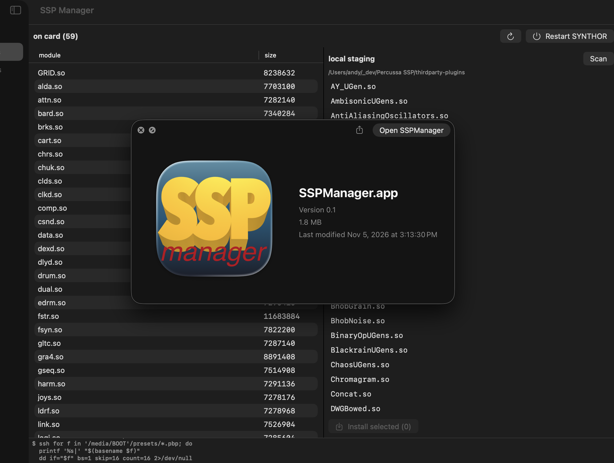
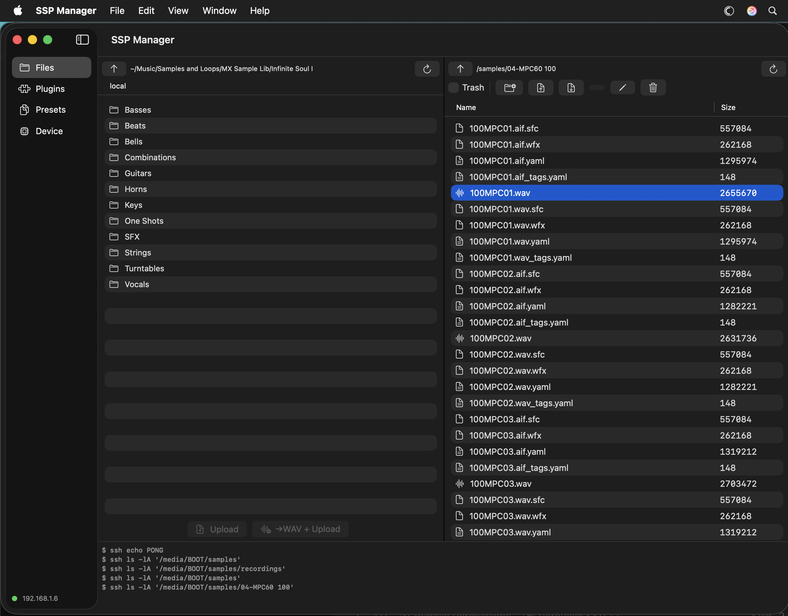
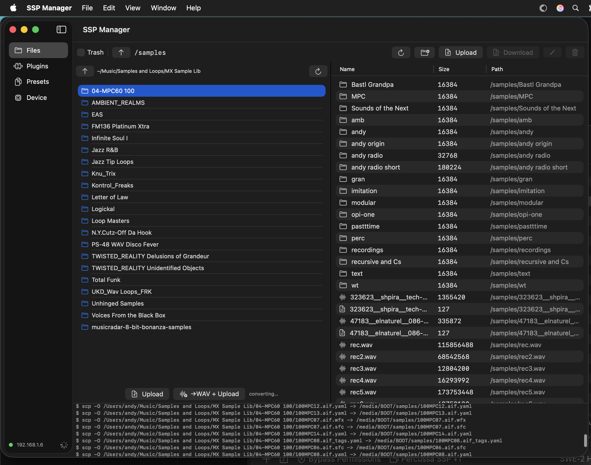
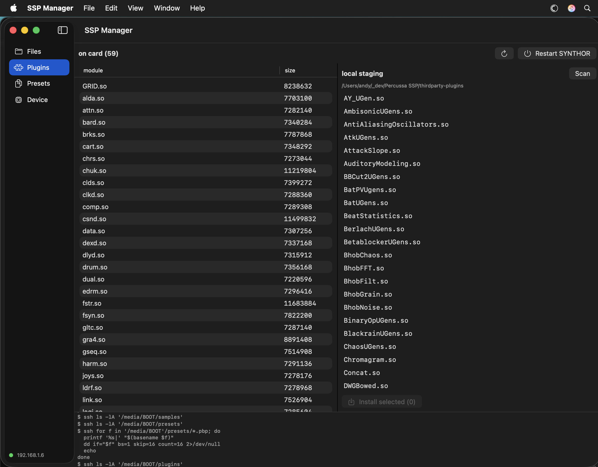
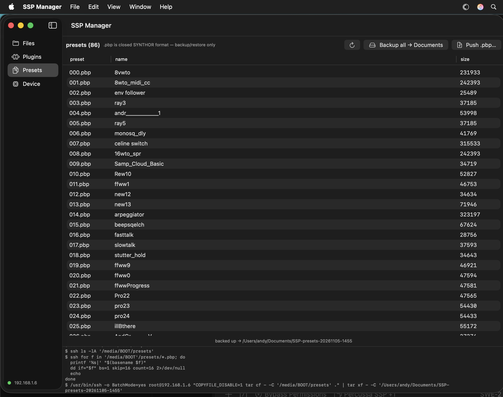

# SSP Manager

A macOS app to manage the **Percussa SSP** eurorack module over SSH — files,
plugins, presets and sample conversion without pulling the SD card.

## Screenshots

| | |
|---|---|
|  |  |
|  |  |

## Features

### Files — dual-pane browser (local ⇄ card)

- Left: your Mac's filesystem (starts in `~/Music`, single-click folders to navigate)
- Right: the SSP's SD card (`/media/BOOT`, default `samples/`)
- Navigate, mkdir, rename, upload, download, multi-select
- Transfers keep going if you browse another folder mid-upload (SSP dropbear
  only handles one SSH session — browse/list waits in line instead of aborting)
- Folder uploads rewrite FAT-illegal path characters (`:` `*` `?` etc. → `-`)
  so libraries like `60:120bpm` kits don't make busybox tar error out mid-tree
- Delete moves files to `.trash` on the card first — no journaled filesystem,
  so nothing is lost by accident
- **Convert on upload**: `→WAV + Upload` transcodes `.aif/.flac/.mp3/.m4a/.ogg`
  to 24-bit WAV using macOS `afconvert` (no dependencies) while transferring.
  Butter-compatible sidecars are renamed to match (`x.aif.yaml` → `x.wav.yaml`,
  plus `_tags`/`_edits`/`.sfc`/`.wfx`) and folder trees are preserved —
  select a sample library folder and it lands on the card converted and intact.

### Plugins

- Inventory of `.so` modules on the card vs a local staging folder
- Select + install, then restart SYNTHOR (plugins only scan at startup)
- AppleDouble `._*` junk from macOS copies is filtered and avoided on upload

### Presets

- Lists every `NNN.pbp` on the card **with its embedded preset name**
  (16-byte ASCII field at offset 16 in the file)
- Backup all → `~/Documents/SSP-presets-<date>/` as `NNN - name.pbp`
  so Finder shows real names
- Push files back — the `NNN - ` prefix is stripped to restore the slot
  (e.g. `000 - 8vwto.pbp` → `000.pbp`), and a remote snapshot is taken first
- `.pbp` is closed SYNTHOR state — backup/restore only until the format
  is documented or decoded

### Device

- Host IP, connectivity, free space, SYNTHOR restart
- Live command log across the bottom of every pane

## Requirements

- An SSP reachable over SSH: any USB-ethernet dongle in the left USB port.
  Stock firmware defaults to `192.168.1.6` — give your Mac a static IP on the
  same subnet (e.g. `192.168.1.10/24`), then:

      ssh-copy-id root@192.168.1.6    # password is 123456 on stock images

  The app shells out to `ssh`/`scp` (BatchMode, so keys are required — no
  password prompts).

## First run

1. Build/download (below), open the app — unsigned build, so
   right-click → Open if Gatekeeper complains.
2. Device pane: set **Host** to your SSP's IP (default `192.168.1.6`)
   and **Card root** if it differs — `/media/BOOT` on the 2022 image,
   `/media/linaro/SYNTHOR` on older images.
3. Green dot = connected. The log at the bottom shows every ssh call
   it makes — handy when something doesn't respond.
4. Plugins pane: point *local staging* at any folder of `.so` files
   you want to install (downloads from community releases).

## Build

    swift run                    # development
    ./scripts/make_app.sh        # build/SSPManager.app

or grab `SSPManager.app.zip` from the latest Release.

macOS 14+, no dependencies beyond the system `ssh`, `scp`, `tar` and
`afconvert`.

## Status / roadmap

Early and practical. Preset *editing* (module layout, routing, parameters)
is blocked on the closed `.pbp` format — if you have docs, get in touch.
Planned: TRAX preset authoring (text format inside a module slot), patch
recipes, sidecar sync.

MIT licensed.
